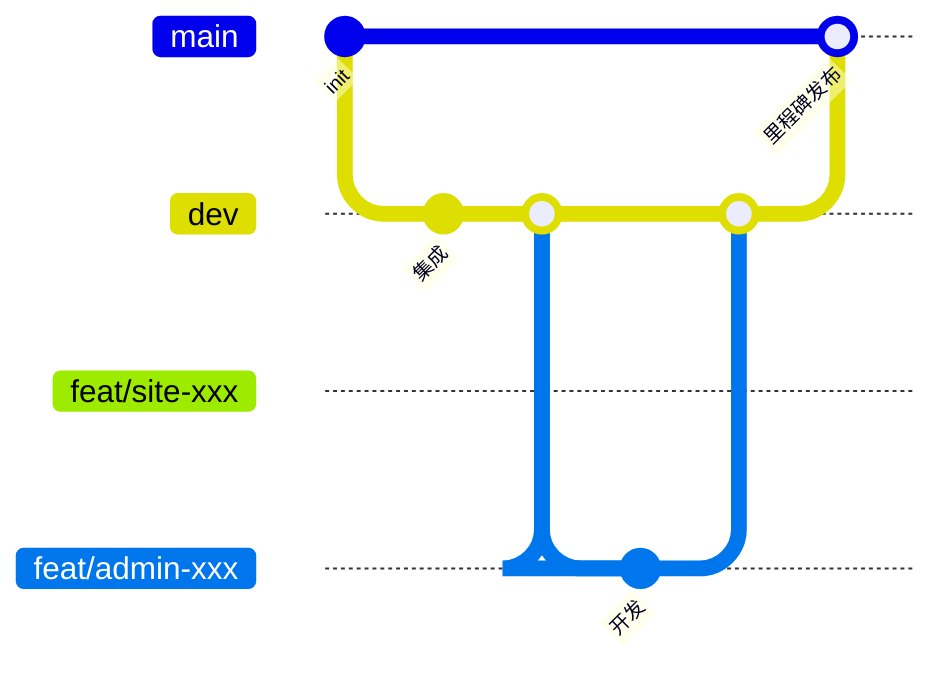

# 游戏行业匿名评价平台 · 协作规范

> 版本 v1.0 ｜ 2026-11-20 ｜ 适用范围：`baikebudaquan/Game-Developer-Review`
> 配套文档：[技术方案.md](./技术方案.md)

---

## 1. 角色与职责

| 角色 | 人数 | 负责 | 不负责 |
| --- | --- | --- | --- |
| 负责人 | 1 | 网站与问卷的内容审核、产品决策、上线放行 | 不写代码、不要求懂技术细节 |
| 开发 A | 1 | 系统开发（按系统分工） | —— |
| 开发 B | 1 | 系统开发（按系统分工） | —— |

核心原则：**分支按「一件事」走，不按「人」或「系统」走；系统靠目录划分，环境靠分支划分。**

---

## 2. 分支模型

长期只保留两条分支，开发一律走短命分支。



| 分支 | 生命周期 | 作用 | 谁能推 | 保护规则 |
| --- | --- | --- | --- | --- |
| `main` | 长期 | 生产：GitHub Pages 部署 + 已审核数据 | 仅通过 PR | 强制 PR + 1 人 approve + `data-validate` 通过；禁止 force push、禁止直接 push |
| `dev` | 长期 | 集成 / 预发布，日常合并目标 | 通过 PR（小改可直推） | CI 必须通过；禁止 force push |
| `feat/survey-*` | 1–3 天 | 问卷页、提交 API、D1 | 本人 | 合并后立即删除 |
| `feat/admin-*` | 1–3 天 | 审核控制台 | 本人 | 合并后立即删除 |
| `feat/site-*` | 1–3 天 | 展示站 | 本人 | 合并后立即删除 |
| `chore/schema-*` | 1–2 天 | 数据契约、CI、脚本、依赖 | 提出者 | **两人 review，优先合并** |
| `hotfix/*` | 小时级 | 线上紧急修复，从 `main` 拉 | 本人 | 修完同时合回 `main` 与 `dev` |
| `docs/*` | 1 天 | 文档、方案、规则 | 任何人 | 合并后删除 |

### 2.1 分支命名

格式：`<类型>/<范围>-<简述>`，全小写，单词用 `-` 连接。

```text
feat/site-company-detail
feat/survey-pow-retry
feat/admin-review-list
chore/schema-review-v1
hotfix/pages-build-fail
docs/collaboration-rules
```

禁止的命名：`dev2`、`test`、`zhangsan`、`问卷系统`、`v2`。

---

## 3. 日常开发流程

```powershell
# 1. 开工：更新 dev，拉功能分支
git switch dev
git pull origin dev
git switch -c feat/site-company-detail

# 2. 开发中：每天至少同步一次，优先 rebase
git fetch origin
git rebase origin/dev

# 3. 提交：小步提交，一个提交只说一件事
git add -A
git commit -m "feat(site): 增加公司详情页评分分布图"

# 4. 推送并开 PR 合回 dev
git push -u origin feat/site-company-detail

# 5. 合并后清理
git switch dev
git pull origin dev
git branch -d feat/site-company-detail
git push origin --delete feat/site-company-detail
```

规则：

- 分支存活不超过 3 天，超过说明任务切得太大，拆开。
- 每天至少往 `dev` 合一次，不允许攒三天以上再合。
- 同步用 `rebase`，合并进 `dev` 用 squash 或 merge commit（仓库内统一一种）。
- 一个人干活时，改文案、调样式、修小 bug 可直推 `dev`；但满足任一条件必须开分支：跨多个文件、超过半天工作量、动了 `schema/` 或 `data/`、需要他人查看。

---

## 4. PR 规则

1. **一个 PR 只动一个系统**，跨系统改动先合 `chore/schema-*`，再分头开发。
2. PR 控制在 **400 行以内**，超过先拆分。
3. PR 标题同提交信息格式，正文写清楚：改了什么、为什么、怎么验证。
4. 涉及 `schema/`、`data/`、`.github/` 的 PR 必须两人 review。
5. 涉及内容的 PR（问卷文案、字段、审核红线、示例数据）标题加 `content:` 前缀，由负责人 approve。
6. 所有 CI 必须通过才能合并；失败不许强行绕过。
7. 合并后立即删除源分支。

### 4.1 PR 模板要点

```markdown
## 改了什么
## 为什么
## 如何验证（预览链接 / 截图 / 执行命令）
## 影响范围（site / survey / admin / schema / data）
```

---

## 5. 审核与上线

负责人不写代码，只通过 PR 与预览链接参与审核。

| 环节 | 谁 | 做什么 |
| --- | --- | --- |
| 日常开发 | 开发 | `feat/*` → PR → `dev`，开发之间互看 |
| 内容审核 | 负责人 | 看 `content:` PR 的预览链接，确认文案、字段、审核红线 |
| 集成验收 | 开发 | 在 `dev` 对应预览环境跑通完整链路 |
| 上线放行 | 负责人 | approve `dev → main` 的 PR |
| 发布 | 开发 | 合并后确认 Pages 部署成功 |

- 每个功能 PR 必须带可访问的预览链接（Cloudflare Pages PR preview / 展示站 PR 预览）。
- `dev → main` 按里程碑合入（M1 展示骨架、M2 提交链路、M3 控制台、M4 发布管线、M5 上线加固），`main` 保持随时可上线。
- 上线后出问题：从 `main` 拉 `hotfix/*`，修复后同时合回 `main` 和 `dev`。

---

## 6. 提交信息规范

采用 Conventional Commits，`scope` 用系统范围：`site` / `survey` / `admin` / `schema` / `data` / `ci` / `docs`。

```text
<type>(<scope>): <中文描述>

feat(site): 增加公司榜单搜索
fix(survey): 修复提交超时未进入兜底状态
chore(schema): review 增加 revision 字段
docs: 新增协作规范
data: 新增 10 条示例评价
```

| type | 用途 |
| --- | --- |
| `feat` | 新功能 |
| `fix` | 修复缺陷 |
| `chore` | 构建、依赖、schema、CI |
| `docs` | 文档 |
| `refactor` | 重构（不改行为） |
| `test` | 测试 |
| `data` | 数据文件变更 |

---

## 7. 目录所有权与 CODEOWNERS

| 路径 | 系统 | 主要归属 | 备注 |
| --- | --- | --- | --- |
| `survey/`、`functions/` | 问卷系统 | 开发 A 或 B | 提交链路、PoW、D1 |
| `admin/` | 后台系统 | 开发 B 或 A | 审核控制台 |
| `site/` | 网站系统 | 开发 B 或 A | 展示站、构建期取数 |
| `schema/`、`data/`、`scripts/` | 数据与构建 | 两人共同 | 改动必须两人 review |
| `.github/` | CI | 两人共同 | 改动必须两人 review |
| `docs/` | 文档 | 任何人 | —— |

CODEOWNERS 草案（放到 `.github/CODEOWNERS`）：

```text
# 数据契约与构建：必须两人评审
/schema/        @devA @devB
/data/          @devA @devB
/scripts/       @devA @devB
/.github/       @devA @devB

# 三个系统
/survey/        @devA
/functions/     @devA
/admin/         @devB
/site/          @devB

# 文档
/docs/          @owner @devA @devB
```

---

## 8. 仓库保护配置

### 8.1 `main`

- Require a pull request before merging：开启
- Required approvals：1
- Require status checks：`data-validate`、`site-build`
- Require branches to be up to date：开启
- Allow force pushes：关闭
- Allow deletions：关闭
- 限制直接推送：仅 Actions 与合并 PR

### 8.2 `dev`

- Require status checks：开启
- Allow force pushes：关闭
- Allow deletions：关闭

### 8.3 通用

- 开启 Dependabot 与 Code scanning（公开仓免费）。
- Actions 权限最小化，workflow 固定版本 tag，不用 `@master`。
- 开启 `Secret scanning` 与 `Push protection`，防止 PAT 误提交。

---

## 9. 冲突与同步

- 冲突自己解决，解决前先 `git fetch` 看清对方改了什么，不要盲选「接受我的」。
- `package-lock.json`、`data/**` 冲突优先保留对方的最新意图，重跑 `npm install` / `scripts/validate.mjs` 验证。
- 同一条数据文件（`data/reviews/**`）两人同时改的概率要压到零：评价只由控制台写入，人不在本地手改数据文件。
- `dev` 落后于 `main`（hotfix 后）立即把 `main` 合回 `dev`，避免两条线分叉。

---

## 10. 禁止事项

- 禁止在 `main` 上直接提交、force push、删除分支。
- 禁止用长期分支代表系统（`survey-system`、`admin-system` 这类分支不允许存在）。
- 禁止把未审核的提交内容放进公开仓的任何分支。
- 禁止把管理员 token、Cloudflare 凭据写进代码、日志、commit message。
- 禁止绕过 CI 合并、关闭分支保护。
- 禁止 `git push --force` 到 `dev` 和 `main`。
- 禁止在一条 PR 里同时改问卷、后台、站点三套代码。

---

## 11. 里程碑与发布节奏

| 里程碑 | 触发合并 | 负责放行 |
| --- | --- | --- |
| M0 数据契约 | `chore/schema-*` 合入 `dev` | 两位开发 |
| M1 展示骨架 | `dev` 验收后合 `main` | 负责人 |
| M2 提交链路 | 同上 | 负责人 |
| M3 审核控制台 | 同上 | 负责人 |
| M4 发布管线 | 同上 | 负责人 |
| M5 上线加固 | 同上 | 负责人 |

- 每个里程碑在 `main` 上打 tag：`m1-site-skeleton`、`m2-submit-flow` 等，便于回滚对照。
- 非常规发布（hotfix）不占里程碑编号，单独 tag `hotfix-YYYYMMDD`。
